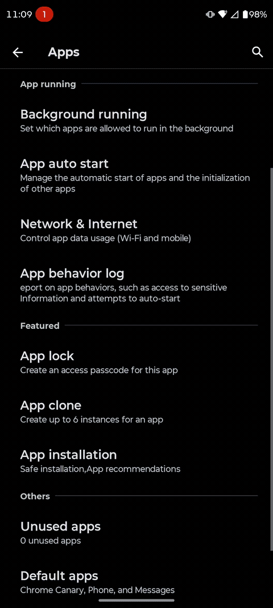

# Moto App Clone

Create more app clones with Motorola’s built-in app cloning. Keep using the
stock cloning interface, launcher icons and separate app data—no repackaged APKs
or separate clone manager.

## Requirements

- A Motorola device running Android 16 or later with native app cloning.
- Vector or another LSPosed-compatible framework with legacy Xposed API 93
  support, including method deoptimization.

Compatibility is checked against the available system interfaces, not a model
name or firmware fingerprint. Firmware implementations differ; passing those
checks does not guarantee every app or device works.

## Install

1. Download `MotoAppClone.apk` and its checksum from
   [Releases](https://github.com/doccstat/motoappclone/releases).
2. Verify it with `sha256sum -c MotoAppClone.apk.sha256`, then install the APK
   in the main user.
3. Enable the module in your framework manager. Select **System Framework** and
   the relevant recommended app scopes, including Motorola’s cloning interface
   and launcher. App-local hooks also need the module enabled in that user.
4. Reboot to load the system hooks, then manage clones through Motorola’s normal UI.

The module does not create, delete, rename or migrate profiles automatically.
Release APKs cannot normally update older debug-signed installations in place;
plan a signer change separately without deleting clone profiles.

## Limits and precautions

The configured quota and running-user limit are **21472**, not a practical
capacity guarantee. Allocation respects the platform’s user-ID bounds and
existing users. Memory, storage and system limits will be reached much earlier.

Profile retention depends on compatible hooks being active at boot. Disabling
the module or changing firmware can expose extended clones to Motorola’s
cleanup. Use disposable data until your device’s creation, launch, reboot and
removal behavior has been checked. Boot success alone does not prove app
isolation, notifications, input methods or biometrics work correctly.

For build instructions, compatibility details and a redacted diagnostic export,
see [BUILDING.md](https://github.com/doccstat/motoappclone/blob/main/BUILDING.md).
Report problems through [Issues](https://github.com/doccstat/motoappclone/issues).
